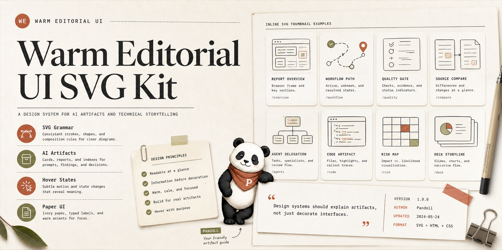

# Warm Editorial UI SVG Kit

Warm Editorial UI SVG Kit is a portable design kit for turning AI reports, article summaries, unknown reviews, planning briefs, and code artifacts into warm editorial HTML pages with matching inline SVG drawings.

It packages:

- A reusable Warm Editorial UI Codex skill.
- CSS tokens and component patterns.
- An SVG drawing style guide.
- A browser-renderable SVG harness.
- A 10-type SVG sample gallery for adapting the style to new artifacts.

## Use

Open the examples directly in a browser:

- `examples/svg-style-harness.html`
- `examples/svg-sample-types.html`
- `examples/svg-variant-gallery.html`
- `examples/warm-editorial-template.html`

For Codex skill use, copy `skill/SKILL.md`, `skill/openai.yaml`, `docs/`, and the `assets/` / `examples/` files into a local `warm-editorial-ui` skill folder.

## Design Direction

The style is intentionally document-first:

- Ivory page background.
- White paper surfaces.
- Serif headings.
- Mono labels and metadata.
- Thin warm-gray borders.
- Restrained clay and olive accents.
- Inline SVGs that explain the artifact instead of decorating it.

## SVG Grammar

The SVG system favors simple, inspectable primitives:

- `rect`, `line`, `circle`, `path`, and occasional `polyline`.
- Fixed viewBox geometry, usually `0 0 120 80` for thumbnails.
- Slate primary strokes, warm-gray secondary strokes, clay for active/risk states, olive for resolved states.
- Hover states that move the card and change one meaningful SVG detail.

See `docs/svg-style-guide.md` for the full rule set.

## Attribution

The visual research was informed by the HTML Effectiveness unknowns reference pages, whose source files include:

`Copyright 2026 Anthropic PBC · SPDX-License-Identifier: Apache-2.0`

This kit is a reusable reconstruction and adaptation of the observed style grammar, not a verbatim redistribution of the original pages.

## License

Apache License 2.0. See `LICENSE`.
